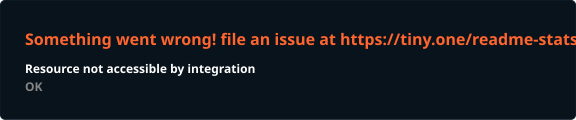

<h3 data-importer="text" align="left">Luiz Philippe</h3>

###

Opa, me chamo Luiz Philippe, sou estudante do curso médio técnico em Informática no Instituto Federal de Alagoas (IFAL) e entusiasta de tecnologia, desenvolvimento de software e segurança da informação.  Atualmente, dedico meus estudos diários ao desenvolvimento web utilizando Python, Django, HTML e CSS, além de utilizar o Linux no meu dia a dia para a configuração de ambientes e ferramentas de diagnóstico. Tenho forte interesse em arquitetura de redes e cibersegurança, buscando compreender a fundo o funcionamento dos sistemas para aplicar boas práticas na construção de soluções sólidas.  Este perfil reúne meus projetos e documenta minha evolução prática na tecnologia, servindo como base estruturada para a atuação no mercado. Fora da programação tradicional, gosto de exercitar a lógica, o pensamento analítico e a resolução de problemas explorando desde jogos competitivos até o desenvolvimento de experiências interativas e jogos inteiramente funcionais dentro do Microsoft PowerPoint.

###

<h3 data-importer="text" align="left">Linguagens e aplicações que mais utilizo</h3>

###

  
  
  
  
  
  
  
  
  
  
  
  
  
  
  
  
  
  
  

###

<h3 data-importer="text" align="left">Minha Atividade</h3>

###

  
  

###

<h3 data-importer="text" align="left">Meu GitHub</h3>

###

<picture data-importer="pacman">
  <source media="(prefers-color-scheme: dark)" srcset="https://raw.githubusercontent.com/Luiz-Philippe/Luiz-Philippe/pacman-output/bomberman-contribution-graph-dark.svg?game=bomberman">
  <source media="(prefers-color-scheme: light)" srcset="https://raw.githubusercontent.com/Luiz-Philippe/Luiz-Philippe/pacman-output/bomberman-contribution-graph.svg?game=bomberman">
  
</picture>

###

  

###
